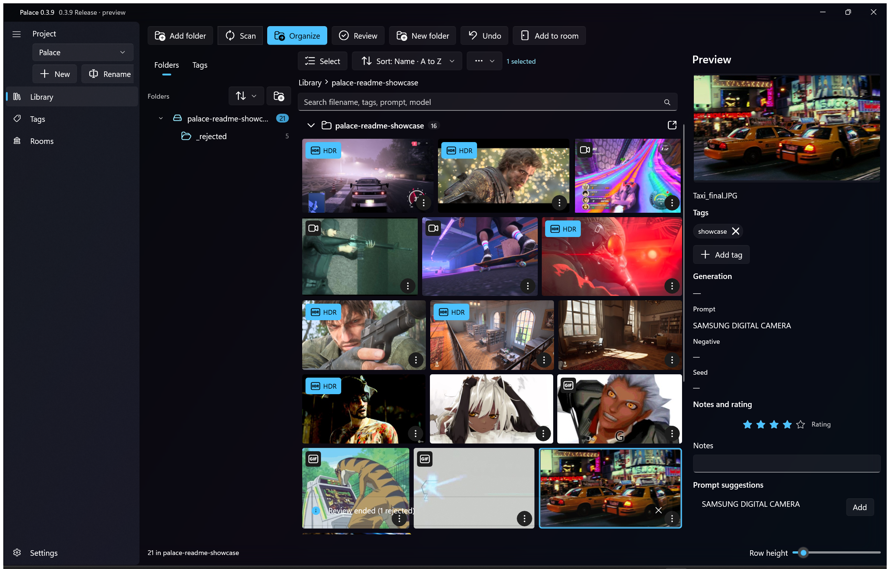
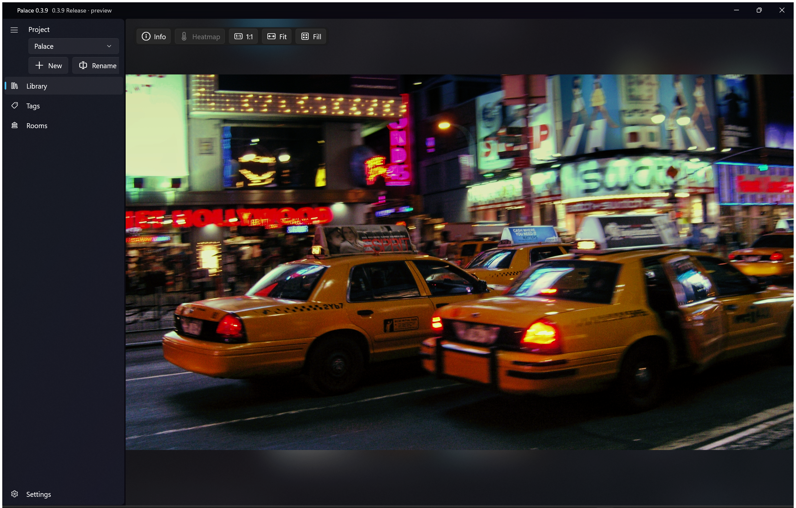
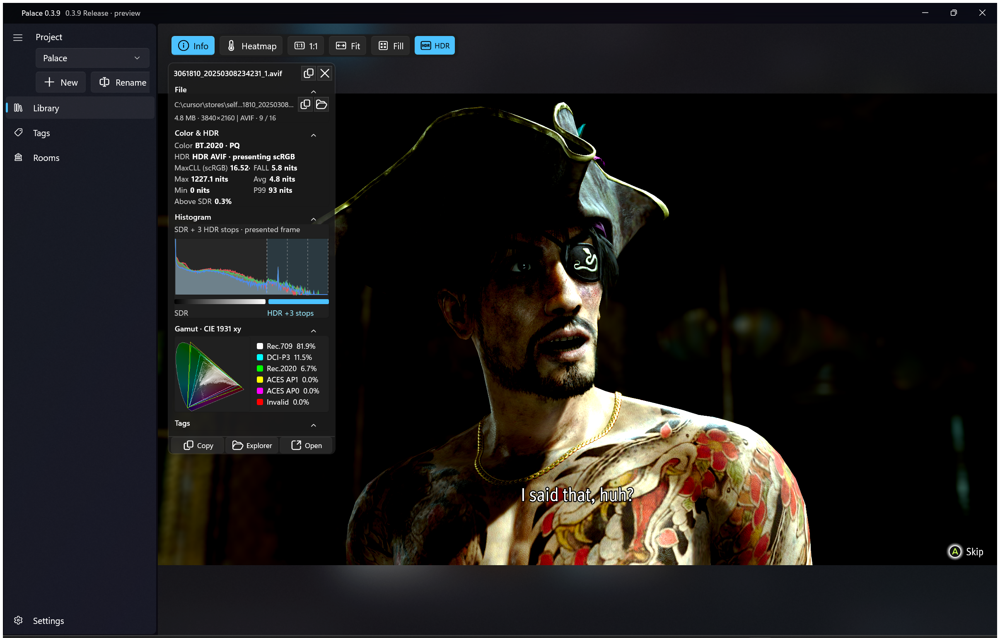

# Palace

Palace is a Windows app for managing images, references and game assets. Your files stay where they are on disk. Palace watches the folders you point it at, keeps a searchable catalog, and lets you browse, preview, tag and organize everything in one place.

It is built with WinUI 3 and the Windows App SDK, with SQLite (FTS5) as the catalog index. The name comes from the "mind palace" idea: the **Library** is the catalog, and **Rooms** will be moodboards and mind maps.

> **Status: 0.3.9** (Settings restructure milestone). The Library — browsing, previews, tags, watched folders, search, and the gallery viewer — is the focus. Rooms, on-disk organization and cloud support exist but are early.


*Keep, reject, or skip — Review through your library in one pass.*

(First-frame still: [`docs/screenshots/01-hero.png`](docs/screenshots/01-hero.png).)

## Install

**Microsoft Store:** coming soon.

**Developer build:** build and run from source as described in [Build and run](#build-and-run).

## Library



*Browse, tag and rate your whole library.*

## Features

- **Projects.** Each project has its own library of watched folders. Switch or create projects from the sidebar.
- **Watched folders.** Add a folder and Palace scans it and keeps it up to date as files change. Files are never moved or copied unless you ask.
- **Library mosaic.** A thumbnail grid with adjustable row height, grouped by subfolder, plus a full-screen gallery/overlay viewer for images, GIFs and video. Long-press or select mode for multi-select and batch actions.
- **Review mode.** A focused keep / reject / skip pass over a queue — swipe or hotkeys, with rejects moved into a sibling `_rejected` folder. See [Review mode](#review-mode).
- **Viewer.** Overlay and separate Gallery window with Fit / 1:1 / Fill, Details card, volume control, GIF frame scrub, and touch gestures (swipe next/prev outside Review).
- **Search.** Full-text search over file names, tags, prompts and model metadata.
- **Global tags.** Tags are shared across all projects. Tags can be grouped and nested, filtered with Any / All / None, starred and colored.
- **Implied tags.** Give a tag implications so that assigning it also applies the implied tags automatically.
- **Tag export and import.** Back up your tag set as JSON from Settings and merge it back in later.
- **Settings.** Two-pane Settings with search: Appearance (accent, density, glass backgrounds), Library & Folders, Viewer, Tags & Rooms, Input, Performance, and About.
- **HDR.** HDR files are detected and badged, presented in HDR on HDR displays, and tone-mapped for SDR. Supported kinds include Ultra HDR JPEG, HDR PNG, HDR AVIF/HEIF, JPEG XR, JPEG XL, OpenEXR and Radiance `.hdr` (for example `sample.exr` or `lapa_1k.hdr`). A shared `Palace.Imaging` pipeline (normalize → tone-map) is landing in phases — see [Imaging rewrite](#imaging-rewrite).
- **Durable catalog.** The catalog lives outside the app package, so reinstalling Palace does not wipe your projects and tags (see [Where your data lives](#where-your-data-lives)).
- **Early features:** Rooms (create rooms and pin assets into sectioned grids), dry-run and optional auto organize with undo, Recycle Bin delete, and Dropbox / OneDrive "online-only" files without mass re-downloading.

### Review mode

Review mode is a dedicated triage pass in the Library gallery overlay. You work through a frozen queue one asset at a time — keep it, skip it for later, or reject it (Palace moves the file into a sibling `_rejected` folder next to the asset). Outside Review, browse swipes only change the current image; they never keep or reject.

**Enter Review** from the Library toolbar **Review** button (also under the overflow menu). If tiles are selected, those become the queue; otherwise Palace uses the visible mosaic (non-headers, skipping anything already under `_rejected`). The overlay opens on the first item and the queue stays fixed for the session.


- **Keep:** swipe right or `K`
- **Reject:** swipe left or `X`; the image moves to `_rejected` and can be undone
- **Skip:** swipe up or `S`
- **Undo:** `Ctrl+Z`


### Full viewer



*Full-screen viewer with swipe and keyboard navigation.*

### HDR



*Native HDR display (AVIF/JXR/EXR…), tone-mapped on SDR screens.*

### Supported formats

| Kind | Extensions |
| --- | --- |
| Images | `.jpg` `.jpeg` `.png` `.webp` `.bmp` `.tif` `.tiff` `.avif` `.heic` `.heif` `.jxr` `.wdp` `.hdp` `.jxl` `.hdr` `.psd` `.psb` `.dds` `.exr` `.tga` `.ico` `.clip` (Clip Studio Paint) |
| Animated | `.gif` |
| Video | `.mp4` `.mov` `.mkv` `.webm` `.avi` |

EXR, TGA, ICO, PSD/PSB, JPEG XL and Clip Studio files are decoded by Palace itself, so they don't need extra Windows codecs. Files with an image extension that aren't really images get a placeholder tile. Video thumbnails that Windows can't make itself (for example MKV with H.264 4:4:4, or WebM/AV1 without the Store codec extensions) come from a small bundled LGPL ffmpeg.

### Imaging rewrite

Palace is migrating still decode and present onto a pure `Palace.Imaging` library (BT.2020 linear working space, 1.0 = 203 nits, Option A tone-map). Progress:

| Phase | Status |
| --- | --- |
| **P0** | Landed — stopgap freeze of the old present path |
| **P1** | Landed — `Palace.Imaging` + unit tests (no UI) |
| **P2** | Landed — still decoders → `NormalizedFrame` (+ small follow-ups) |
| **P3+** | Pending — thumbs / full-view flags |
| **P4–P5** | Pending — SDR full view, then HDR present + HLSL |
| **P6–P7** | Later — delete legacy path; gain maps / desat engagement |

Until P4–P5 land, the gallery still uses the existing present path for full view. See [`docs/hdr-sdr-tuning.md`](docs/hdr-sdr-tuning.md). Agent surface: `AGENTS.md` and `.cursor/rules/gallery-hdr.mdc`.

## Requirements

- Windows 10 version 1809 (build 17763) or later, x64
- An HDR-capable display is optional, for HDR presentation

## Build and run

You need:

- Windows, x64
- [.NET 10 SDK](https://dotnet.microsoft.com/download)
- WinApp CLI (`winget install --id Microsoft.WinAppCli`) for packaged runs

Palace is a **packaged** WinUI 3 app. Always run the packaged **Debug** build via `BuildAndRun.ps1`, never the unpackaged `.exe` and never `WindowsPackageType=None`.

For local agent / laptop runs, prepare a **test** package identity first (do **not** register over the release Identity `C20A7629-…`):

```powershell
.\scripts\Prepare-TestIdentity.ps1 -IdentityName PalaceOrganizeTest-5E1F
$env:PALACE_DATA_DIR = Join-Path $env:TEMP 'palace-agent-data'
.\BuildAndRun.ps1 . --arch x64
```

`Prepare-TestIdentity.ps1` **patches `Package.appxmanifest` in place** (Name, PhoneProductId, DisplayName) to a **test** identity. Restore that file from git or the script’s `.release-backup` **before committing** so the **test** identity is never committed. `BuildAndRun.ps1` builds and launches the packaged Debug layout under that test identity. Register the **build output** `AppxManifest.xml`, not `winapp run --no-launch` on the source manifest.

The build downloads a slim, static LGPL ffmpeg (about 12 MB) for video thumbnails and packages it with the app. The download comes from this repo's GitHub releases and is checked against a pinned SHA-256 by `tools/Get-Ffmpeg.ps1`. `tools/build-ffmpeg.sh` rebuilds it from source; its license and source offer ship next to it as `ffmpeg\LICENSE.txt` and `ffmpeg\SOURCE.txt`. To build without it (shell thumbnails only):

```powershell
dotnet build Palace.csproj -c Debug -p:Platform=x64 -p:PalaceBundleFfmpeg=false
```

OpenEXR files (every compression, including PIZ, PXR24, B44 and DWA, plus tiled and multi-part files) are decoded by a small bundled build of the official OpenEXR library (BSD-3, about 2 MB), committed as `Native/openexr/win-x64/palace_exr.dll`. `tools/openexr/build-openexr.sh` rebuilds it from the pinned OpenEXR source (the `openexr` workflow does the same and uploads it as an artifact); its licenses and source info ship next to the app as `openexr\LICENSE.txt` and `openexr\SOURCE.txt`.

### Build and test (same as CI)

CI ([`.github/workflows/ci.yml`](.github/workflows/ci.yml)) runs on `windows-latest` with .NET 10:

```powershell
dotnet restore Palace.csproj -p:Platform=x64
dotnet restore Palace.Tests/Palace.Tests.csproj
dotnet build Palace.csproj -c Debug -p:Platform=x64 --no-restore
dotnet test Palace.Tests/Palace.Tests.csproj -c Debug --no-restore
```

The test project and `Palace.Imaging` target plain `net10.0`, so `dotnet test ./Palace.Tests/Palace.Tests.csproj` also runs on Linux and macOS. The WinUI app itself only builds on Windows.

## Where your data lives

- **Catalog** (`palace.db`: projects, tags, sources, rooms and the asset index) is stored outside the app package, by default in `%LOCALAPPDATA%\Palace\catalog\`. A pointer file, `%LOCALAPPDATA%\Palace\catalog-root.txt`, records the location so it survives uninstall and reinstall. In **Settings → Catalog data** you can move the catalog, export a `.db` copy, or export/import tags as JSON.
- **Package LocalState** (`%LOCALAPPDATA%\Packages\<Palace package>\LocalState\`) holds the thumbnail and preview cache and error logs. It is deleted when the app is uninstalled, so don't rely on it for anything you want to keep.

## Project structure

```
Pages/           Library, Tags, Rooms and Settings pages
Controls/        Reusable UI controls
ViewModels/      Page view models
Models/          UI and data models
Services/        Catalog, scanning, folder watching, thumbnails, HDR, cloud
Helpers/         Format decoders, gallery/HDR helpers, path rules
Data/            SQLite database layer
Palace.Imaging/  Pure normalize + tone-map library (net10.0; P1+)
Palace.Tests/    Unit tests (cross-platform)
tools/           Helper scripts (e.g. Get-Ffmpeg.ps1, build-ffmpeg.sh, openexr/)
docs/            Design notes and README screenshots (`docs/screenshots/`)
Assets/          App icons and package art
```

## Roadmap

- **0.3.x** *(now)* — Settings restructure done; Library / viewer polish (touch, Review mode, mosaic select, HDR imaging rewrite P0–P2). Next: finish imaging present (P3–P5), then 3D and audio, then Rooms moodboard.
- **Later 0.x** — Rooms canvas, gamedev viewers, AI-assisted tagging — only when those minors are opened.
- **1.0** — First public Microsoft Store release.

## Contributing

Issues and pull requests are welcome. Before you start, read [`AGENTS.md`](AGENTS.md). It covers the versioning rules, the Library-first priority, testing expectations and what not to invent, and it applies to people and coding agents alike. Topic-specific notes live in [`.cursor/rules/`](.cursor/rules/).

Docs / CI / tests-only PRs use the `no-version-bump` label (or stay on exempt paths). App-changing PRs bump `<PalaceVersion>` in `Directory.Build.props` and sync the manifest with `python3 scripts/sync-appx-version.py`.

## License

[MIT](LICENSE)
