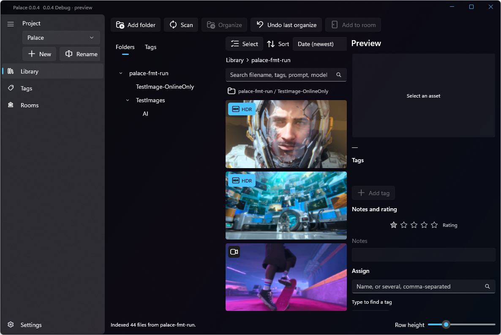
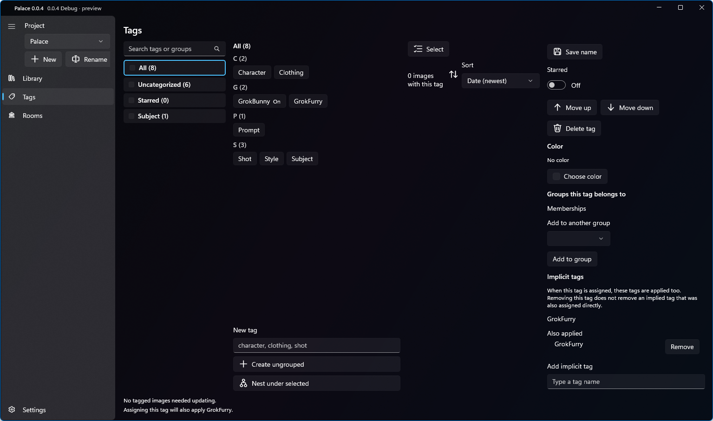
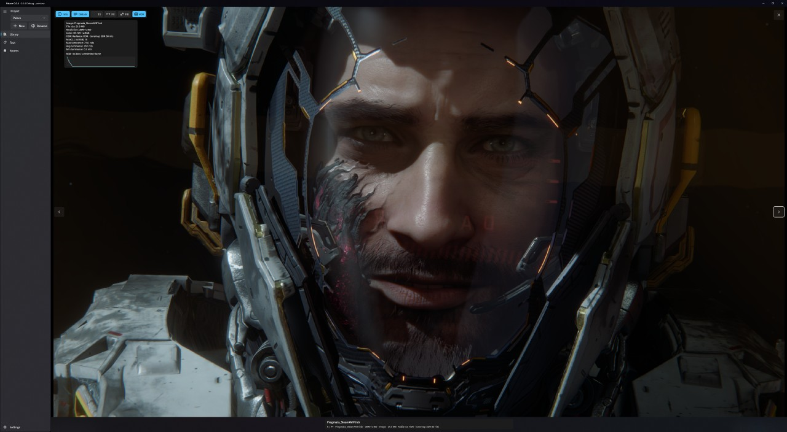

# Palace

Palace is a Windows app for managing images, references and game assets. Your files stay where they are on disk. Palace watches the folders you point it at, keeps a searchable catalog, and lets you browse, preview, tag and organize everything in one place.

It is built with WinUI 3 and the Windows App SDK, with SQLite (FTS5) as the catalog index. The name comes from the "mind palace" idea: the **Library** is the catalog, and **Rooms** will be moodboards and mind maps.

> **Status: 0.0.4, early public preview.** The Library (browsing, previews, tags, watched folders, search) is the focus right now. Rooms, on-disk organization and cloud support exist but are early.



## Features

- **Projects.** Each project has its own library of watched folders. Switch or create projects from the sidebar.
- **Watched folders.** Add a folder and Palace scans it and keeps it up to date as files change. Files are never moved or copied unless you ask.
- **Library mosaic.** A thumbnail grid with adjustable row height, grouped by subfolder, plus a full-screen gallery/overlay viewer for images, GIFs and video.
- **Search.** Full-text search over file names, tags, prompts and model metadata.
- **Global tags.** Tags are shared across all projects. Tags can be grouped and nested, filtered with Any / All / None, starred and colored.
- **Implied tags.** Give a tag implications so that assigning it also applies the implied tags automatically.
- **Tag export and import.** Back up your tag set as JSON from Settings and merge it back in later.
- **HDR.** HDR files are detected and badged, presented in HDR on HDR displays, and tone-mapped for thumbnails. Supported HDR kinds include Ultra HDR JPEG, HDR PNG, HDR AVIF/HEIF, JPEG XR, JPEG XL and Radiance `.hdr`.
- **Durable catalog.** The catalog lives outside the app package, so reinstalling Palace does not wipe your projects and tags (see [Where your data lives](#where-your-data-lives)).
- **Early features:** Rooms (create rooms and pin assets into sectioned grids), dry-run and optional auto organize with undo, Recycle Bin delete, and Dropbox / OneDrive "online-only" files without mass re-downloading.



### Supported formats

| Kind | Extensions |
| --- | --- |
| Images | `.jpg` `.jpeg` `.png` `.webp` `.bmp` `.tif` `.tiff` `.avif` `.heic` `.heif` `.jxr` `.wdp` `.hdp` `.jxl` `.hdr` `.psd` `.psb` `.dds` `.exr` `.tga` `.ico` `.clip` (Clip Studio Paint) |
| Animated | `.gif` |
| Video | `.mp4` `.mov` `.mkv` `.webm` `.avi` |

EXR, TGA, ICO, PSD/PSB, JPEG XL and Clip Studio files are decoded by Palace itself, so they don't need extra Windows codecs. Files with an image extension that aren't really images get a placeholder tile. Video thumbnails that Windows can't make itself (for example MKV with H.264 4:4:4, or WebM/AV1 without the Store codec extensions) come from a small bundled LGPL ffmpeg.



## Requirements

- Windows 10 version 1809 (build 17763) or later, x64
- An HDR-capable display is optional, for HDR presentation

## Install

**Microsoft Store:** coming soon.

**Developer build:** build and run from source as described below.

## Build and run

You need:

- Windows, x64
- [.NET 10 SDK](https://dotnet.microsoft.com/download)
- WinApp CLI (`winget install --id Microsoft.WinAppCli`) for packaged runs

Palace is a packaged app. Always run the packaged Debug build, not the raw `.exe`:

```powershell
.\BuildAndRun.ps1 . --arch x64
```

The build downloads a slim, static LGPL ffmpeg (about 12 MB) for video thumbnails and packages it with the app. The download comes from this repo's GitHub releases and is checked against a pinned SHA-256 by `tools/Get-Ffmpeg.ps1`. `tools/build-ffmpeg.sh` rebuilds it from source; its license and source offer ship next to it as `ffmpeg\LICENSE.txt` and `ffmpeg\SOURCE.txt`. To build without it (shell thumbnails only):

```powershell
dotnet build Palace.csproj -c Debug -p:Platform=x64 -p:PalaceBundleFfmpeg=false
```

### Build and test (same as CI)

CI ([`.github/workflows/ci.yml`](.github/workflows/ci.yml)) runs on `windows-latest` with .NET 10:

```powershell
dotnet restore Palace.csproj -p:Platform=x64
dotnet restore Palace.Tests/Palace.Tests.csproj
dotnet build Palace.csproj -c Debug -p:Platform=x64 --no-restore
dotnet test Palace.Tests/Palace.Tests.csproj -c Debug --no-restore
```

The test project targets plain `net10.0`, so `dotnet test ./Palace.Tests/Palace.Tests.csproj` also runs on Linux and macOS. The WinUI app itself only builds on Windows.

## Where your data lives

- **Catalog** (`palace.db`: projects, tags, sources, rooms and the asset index) is stored outside the app package, by default in `%LOCALAPPDATA%\Palace\catalog\`. A pointer file, `%LOCALAPPDATA%\Palace\catalog-root.txt`, records the location so it survives uninstall and reinstall. In **Settings → Catalog data** you can move the catalog, export a `.db` copy, or export/import tags as JSON.
- **Package LocalState** (`%LOCALAPPDATA%\Packages\<Palace package>\LocalState\`) holds the thumbnail and preview cache and error logs. It is deleted when the app is uninstalled, so don't rely on it for anything you want to keep.

## Project structure

```
Pages/           Library, Tags, Rooms and Settings pages
Controls/        Reusable UI controls
ViewModels/      Page view models
Models/          UI and data models
Services/        Catalog, scanning, folder watching, thumbnails, HDR, cloud
Helpers/         Format decoders (EXR, PSD, TGA, Clip, ...), HDR helpers, path rules
Data/            SQLite database layer
Palace.Tests/    Unit tests (cross-platform)
tools/           Helper scripts (e.g. Get-Ffmpeg.ps1, build-ffmpeg.sh)
docs/            Design notes and README images
Assets/          App icons and package art
```

## Roadmap

- **0.0** Per-project library and tagging, solid image and video viewing
- **0.1** Rooms: moodboards and mind maps
- **0.2** Game dev focus: Markdown, audio, 3D assets, Unity project folders, `.unitypackage` parsing
- **0.3** AI-assisted tagging and organization
- **1.0** Release and Microsoft Store

## Contributing

Issues and pull requests are welcome. Before you start, read [`AGENTS.md`](AGENTS.md). It covers the versioning rules, the Library-first priority, testing expectations and what not to invent, and it applies to people and coding agents alike. Topic-specific notes live in [`.cursor/rules/`](.cursor/rules/).

## License

[MIT](LICENSE)
